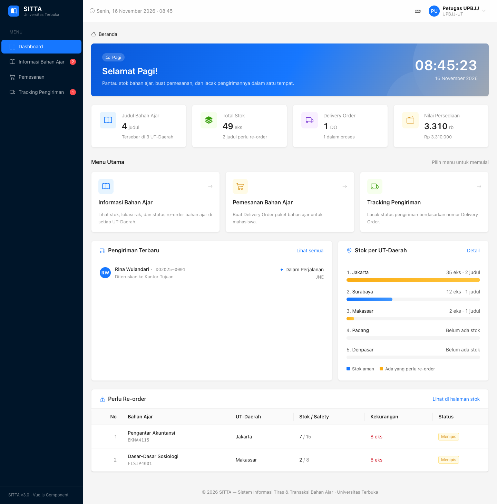
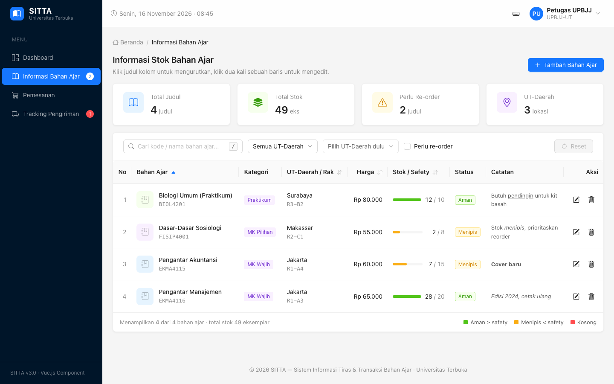
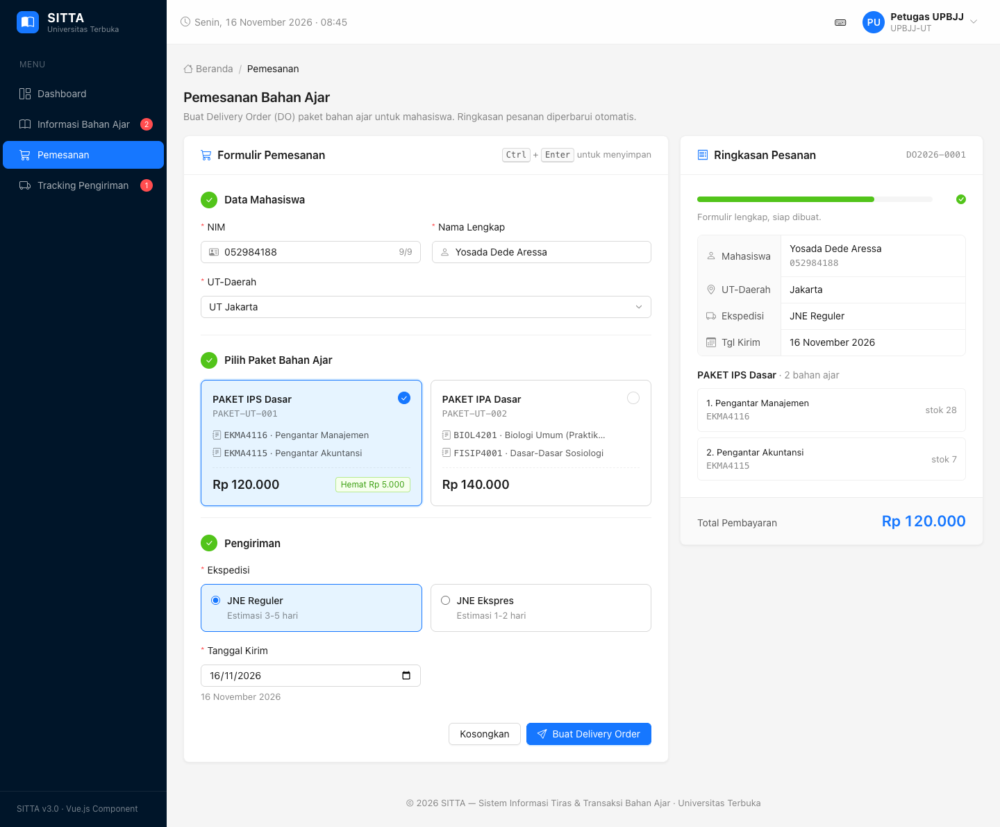
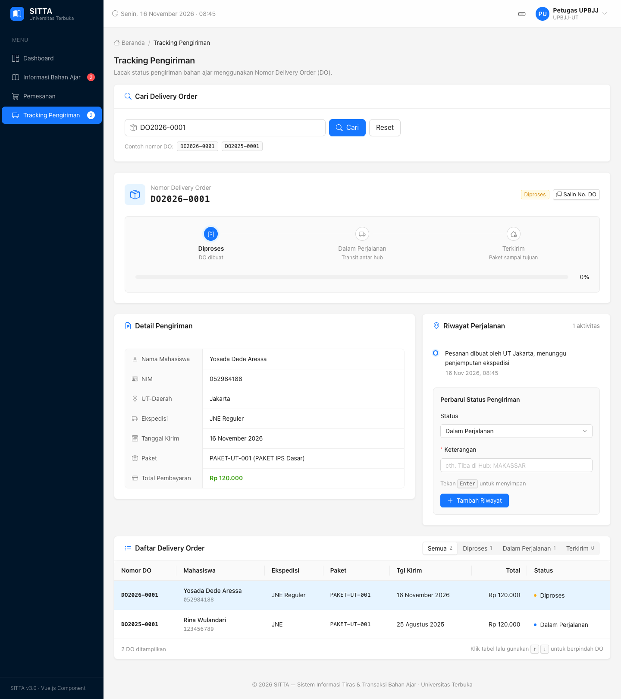
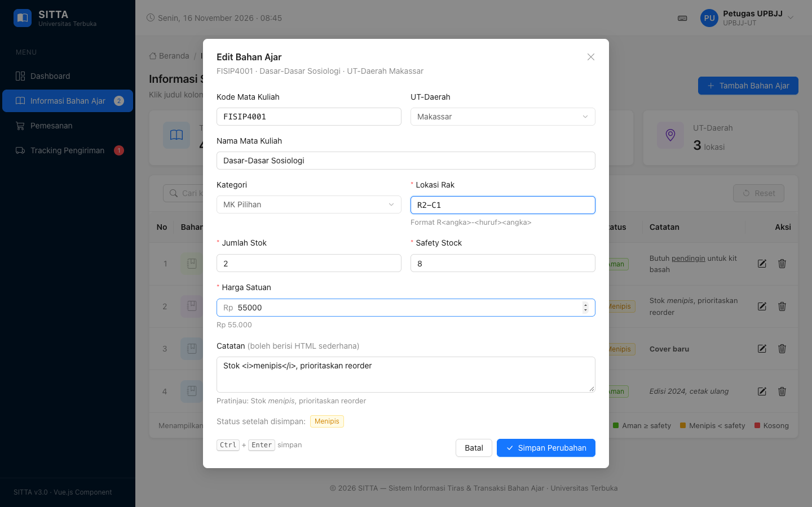
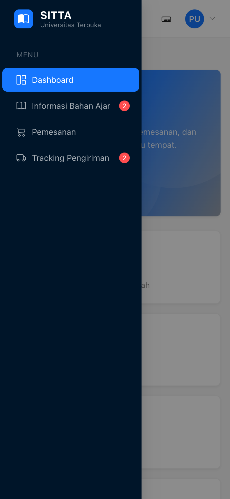

# SITTA UT – Aplikasi Pemesanan Bahan Ajar (Vue Component)

Tugas Praktik 3 mata kuliah **STSI4209 Pemrograman Berbasis Web**, Universitas Terbuka.

## Identitas Mahasiswa

| | |
|---|---|
| **Nama** | Yosada Dede Aressa |
| **NIM** | 052984188 |
| **Program Studi** | Sistem Informasi |
| **Fakultas** | Fakultas Sains dan Teknologi (FST) |
| **UPBJJ** | UT Surakarta |

---

Aplikasi web **satu halaman (SPA)** berbasis **Vue.js 2** untuk proses pemesanan dan distribusi bahan ajar di UT. Seluruh antarmuka disusun dari **Vue Component** yang memakai **property `template`**, lalu dipanggil sebagai **custom element** seperti `<halaman-stok>`, `<badge-stok>`, dan `<modal-dialog>`.

Aplikasi memiliki empat menu:

1. **Dashboard**: ringkasan stok dan DO, jam berjalan, dan menu utama.
2. **Informasi Bahan Ajar**: daftar stok dengan filter dan pengurutan, serta fitur tambah, edit, dan hapus.
3. **Pemesanan**: formulir pembuatan Delivery Order (DO) paket bahan ajar.
4. **Tracking Pengiriman**: pelacakan dan pembaruan status pengiriman.

Tampilan memakai **design system yang sama dengan Tugas Praktik 1** (gaya Ant Design): sider gelap, header berisi jam dan menu pengguna, breadcrumb, card, tag status, tabel, steps, timeline, dan ikon **Bootstrap Icons**.

Data berasal dari *dummy data* `dataBahanAjar.js` dan tidak memakai database.

---

## Tampilan Aplikasi

| Beranda | Stok Bahan Ajar |
|---|---|
|  |  |

| Pemesanan | Tracking DO |
|---|---|
|  |  |

| Modal Edit Stok | Tampilan HP |
|---|---|
|  |  |

---

## Cara Menjalankan

1. Pastikan komputer terhubung ke internet karena Vue.js dan Bootstrap Icons dimuat dari CDN.
2. Buka `index.html` langsung di browser (Chrome, Edge, Firefox, atau Safari).
3. Bisa juga memakai ekstensi **Live Server** di VS Code: klik kanan `index.html` lalu pilih **Open with Live Server**.

Tidak perlu `npm`, *build tool*, maupun server. Data disimpan ke **localStorage**, jadi perubahan tetap ada setelah halaman di-refresh. Untuk mengembalikan data ke kondisi semula, buka menu pengguna di kanan atas lalu klik **"Pulihkan data awal"**.

---

## Struktur Proyek

```
Tugas3/
├─ index.html                     ← Satu-satunya halaman HTML: root template + urutan <script>
├─ css/
│  └─ style.css                   ← Design system Tugas 1 (bagian 1–11) + gaya khusus komponen Tugas 3 (bagian 12)
├─ js/
│  ├─ data/
│  │  └─ dataBahanAjar.js         ← Dummy data dari soal (objek global)
│  ├─ utils.js                    ← Fungsi bantu umum (localStorage, tanggal, status stok)
│  ├─ filters.js                  ← Global filter Vue (rupiah, tanggal, potong, dll.)
│  ├─ components/                 ← Satu file = satu Vue Component (nama file = nama tag)
│  │  ├─ app-sider.js             ← <app-sider> (menu samping)
│  │  ├─ app-header.js            ← <app-header> (jam, menu pengguna)
│  │  ├─ app-footer.js            ← <app-footer>
│  │  ├─ badge-status.js          ← <badge-stok> dan <badge-do>
│  │  ├─ kartu-statistik.js       ← <kartu-statistik>
│  │  ├─ modal-dialog.js          ← <modal-dialog> (memakai slot)
│  │  ├─ notifikasi-toast.js      ← <notifikasi-toast>
│  │  ├─ timeline-perjalanan.js   ← <timeline-perjalanan>
│  │  ├─ daftar-pintasan.js       ← <daftar-pintasan> (isi modal pintasan keyboard)
│  │  ├─ form-bahan-ajar.js       ← <form-bahan-ajar> (form tambah & edit)
│  │  ├─ halaman-beranda.js       ← <halaman-beranda>
│  │  ├─ halaman-stok.js          ← <halaman-stok>
│  │  ├─ halaman-pemesanan.js     ← <halaman-pemesanan>
│  │  └─ halaman-tracking.js      ← <halaman-tracking>
│  └─ app.js                      ← Root instance new Vue({ el: '#app' })
├─ img/                           ← Screenshot untuk README
├─ README.md
└─ PANDUAN-VIDEO.md               ← Alur penjelasan untuk video tugas
```

**Aturan penamaan**
- Nama file komponen memakai **kebab-case** dan sama dengan nama custom element-nya, misalnya `halaman-stok.js` untuk `<halaman-stok>`.
- Komponen halaman diberi awalan `halaman-`, sedangkan komponen kecil yang dipakai ulang diberi nama sesuai fungsinya (`badge-`, `kartu-`, `modal-`, dst.).
- Props ditulis camelCase di JavaScript (`upbjjList`) dan kebab-case di HTML (`:upbjj-list`). Nama event memakai kebab-case (`@tambah-stok`).

**Urutan `<script>` di `index.html`**: Vue, data, utils, filters, komponen kecil, komponen halaman, lalu `app.js` di urutan terakhir. Komponen dan filter harus sudah terdaftar sebelum root instance dibuat.

---

## Arsitektur Komponen

```
new Vue (#app)  ← menyimpan data stok & tracking (satu sumber data)
├─ <app-sider>           props: menu, aktif, lencana        emit: pindah
├─ <app-header>          emit: buka-menu, pintasan, pulihkan
├─ <halaman-beranda>     props: stok, tracking, upbjjList   emit: navigasi
│   ├─ <kartu-statistik> (x4)
│   ├─ <badge-stok>, <badge-do>
├─ <halaman-stok>        props: stok, upbjjList, kategoriList, filterAwal
│   │                    emit: tambah-stok, ubah-stok, hapus-stok
│   ├─ <badge-stok>
│   └─ <modal-dialog>  →  <form-bahan-ajar>   emit: simpan, batal
├─ <halaman-pemesanan>   props: paket, stok, pengirimanList, upbjjList, tracking
│                        emit: buat-do
├─ <halaman-tracking>    props: tracking, paket, statusList, nomorAwal
│   ├─ <badge-do>        emit: perbarui-do
│   └─ <timeline-perjalanan>
├─ <app-footer>          props: keterangan
├─ <modal-dialog>  →  <daftar-pintasan>
└─ <notifikasi-toast>    props: pesan, jenis               emit: tutup
```

Aplikasi memakai pola **props down, events up**:
- Root instance (`app.js`) menjadi **satu-satunya pemilik data** `stok` dan `tracking`.
- Data dikirim ke komponen anak lewat **props** (one-way data flow).
- Komponen anak **tidak mengubah props**. Ia mengirim permintaan perubahan lewat `$emit`, misalnya `this.$emit('ubah-stok', {...})`, lalu root yang menerapkannya.
- Karena semua halaman membaca data yang sama, DO baru dari halaman Pemesanan langsung muncul di Tracking, Dashboard, dan lencana di menu samping.

Navigasi antarmenu memakai `v-if / v-else-if / v-else` pada komponen halaman, dibungkus `<transition>`. Halaman aktif juga disinkronkan dengan hash URL (`#stok`, `#tracking`), sehingga tombol *back* di browser tetap berfungsi.

---

## Pemetaan Kriteria Penilaian

### 1.1 Arsitektur & struktur proyek Vue.js
- Setiap komponen didaftarkan dengan `Vue.component('nama-tag', { props, data, computed, watch, methods, template })`.
- **Property `template`** berisi markup komponen dalam bentuk *template literal* (backtick) di file yang sama. Setiap file komponen berdiri sendiri, mirip Single File Component.
- **Custom element** dipakai di `index.html` maupun di dalam template komponen lain, misalnya `<halaman-stok>` yang berisi `<modal-dialog>`, dan di dalamnya ada `<form-bahan-ajar>`.
- **Slot**: `<modal-dialog>` menerima konten apa pun melalui `<slot>`.
- **Reusable component**: `<form-bahan-ajar>` dipakai untuk mode tambah dan edit melalui prop `modeEdit`. `<badge-stok>` dipakai di Beranda, tabel stok, dan pratinjau form.
- **Validasi props**: setiap prop memiliki `type`, `required`, atau `default`.

### 1.2 Menampilkan data, binding, array (v-for), dan filter
| Konsep | Contoh penerapan |
|---|---|
| Mustache `{{ }}` | `{{ item.judul }}`, `{{ jumlahError }}` |
| `v-text` | lokasi rak `v-text="item.lokasiRak"`, nomor DO di ringkasan pesanan |
| `v-html` | `<td v-html="item.catatanHTML">` dan pratinjau catatan di form |
| `v-bind` (one-way) | `:class="kelasBar(item)"`, `:style="{ width: persenStok(item) + '%' }"`, `:data-period="periode.kode"`, `:disabled`, `:key`, dan semua props komponen |
| `v-model` (two-way) | Semua input, dengan modifier `.trim` dan `.number`, termasuk pada radio dan checkbox |
| `v-for` zero-based index | `v-for="(item, index) in stokTampil"` → kolom **No** `{{ index + 1 }}` |
| `v-for` name-based index | `v-for="(info, daerah, index) in stokPerDaerah"` (Beranda), `v-for="(jumlah, status) in jumlahPerStatus"` (tab Tracking), `v-for="(nilai, label) in infoDO"` (detail DO) |

**Filter** (`js/filters.js`) dipakai dengan tanda pipe:

| Filter | Input → Output | Dipakai di |
|---|---|---|
| `rupiah` | `65000` → `Rp 65.000` | harga, total, nilai persediaan |
| `angka` | `1250` → `1.250` | stok, kartu statistik |
| `tanggal` | `2025-08-25` → `25 Agustus 2025` | tanggal kirim DO |
| `tanggalWaktu` | `2025-08-25 14:07:56` → `25 Agu 2025, 14:07` | timeline perjalanan |
| `potong(n)` | memotong teks panjang dengan `…` (filter dengan argumen) | judul mata kuliah |
| `judulKata` | `budi santoso` → `Budi Santoso` | nama mahasiswa |
| `strip` | nilai kosong menjadi `-` | ringkasan pesanan |

Filter juga dipakai di dalam `v-bind`, misalnya `:keterangan="ringkasan.nilai | rupiah"`, dan dipanggil dari JavaScript melalui `Vue.filter('rupiah')(nilai)` di computed `infoDO`.

### 1.3 Conditional
- `v-if / v-else-if / v-else`: badge status stok (Kosong → Menipis → Aman), badge status DO, ikon notifikasi, breadcrumb, dan navigasi halaman.
- `v-if / v-else`: filter kategori yang bergantung pada UT-Daerah, detail DO atau pesan kosong, form riwayat atau pesan "pengiriman selesai", serta ringkasan paket.
- `v-show`: baris tag filter aktif, tanda centang pada kartu paket, alert jumlah error, dan tombol "Lihat di halaman stok".
- Operator kondisi: `===`, `<`, `!==`, `&&`, `||`, dan ternary, misalnya `:disabled="i < indeksStatus"` agar status DO tidak bisa mundur.

### 1.4 Computed & Methods
- **Computed** dipakai untuk nilai turunan yang di-*cache*: `stokTerfilter`, `stokTampil`, `opsiKategori`, `filterAktif`, `ringkasan`, `stokPerDaerah`, `nomorDOBaru`, `paketTerpilih`, `isiPaket`, `totalHarga`, `persenLengkap`, `langkahLengkap`, `periode`, `daftarDO`, `jumlahPerStatus`, `doTerpilih`, `langkahStatus`, `infoDO`, dan `lencanaMenu`. Hasil filter dan sort hanya dihitung ulang saat data yang menjadi dependensinya berubah.
- **Methods** dipakai untuk aksi (event handler) dan perhitungan yang membutuhkan argumen per item di dalam `v-for`: `urutkan(kolom)`, `persenStok(item)`, `rincianIsi(paket)`, `hematPaket(paket)`, `validasi()`, `kirim()`, `pilihDO(nomor)`, `geserPilihan(langkah)`, `tambahStok()`, `buatDO()`, dan lainnya.

### 1.5 Watchers (14 watcher, syarat minimal 2)
| File | Watcher | Fungsi |
|---|---|---|
| `app.js` | `stok` (deep) | Menyimpan stok ke localStorage setiap kali berubah |
| `app.js` | `tracking` (deep) | Menyimpan DO ke localStorage |
| `app.js` | `halaman` (immediate) | Memperbarui judul tab browser dan hash URL |
| `halaman-stok.js` | `filter.upbjj` | Me-reset filter kategori saat UT-Daerah berganti |
| `form-bahan-ajar.js` | `form.kode`, `form.lokasiRak` | Mengubah isian menjadi huruf kapital otomatis |
| `form-bahan-ajar.js` | `form` (deep) | Validasi langsung setelah form pernah disubmit |
| `halaman-pemesanan.js` | `form.nim` | Hanya menerima angka, maksimal 9 digit |
| `halaman-pemesanan.js` | `form.nama` | Membuang angka dari nama |
| `halaman-pemesanan.js` | `form` (deep) | Validasi langsung |
| `halaman-tracking.js` | `nomorCari` | Mengubah nomor DO menjadi kapital dan menghapus pesan "tidak ditemukan" |
| `halaman-tracking.js` | `nomorTerpilih` (immediate), `doTerpilih.status` | Menyiapkan form riwayat dengan status tahap berikutnya |
| `kartu-statistik.js` | `nilai` (immediate) | Menjalankan animasi angka *count-up* saat nilai berubah |

### 1.6 Formulir, validasi, dan event mouse & keyboard
**Validasi**
| Form | Aturan |
|---|---|
| Tambah bahan ajar | Kode: 4–5 huruf + 4 angka dan tidak boleh duplikat di UT-Daerah yang sama. Nama minimal 3 karakter. Kategori dan UT-Daerah wajib. Rak berformat `R1-A3`. Harga > 0. Stok dan safety berupa bilangan bulat ≥ 0 |
| Edit bahan ajar | Field identitas (kode, judul, kategori, UT-Daerah) dikunci, field lainnya divalidasi seperti di atas |
| Pemesanan | NIM 9 digit. Nama minimal 3 huruf. UT-Daerah, paket, dan ekspedisi wajib. Tanggal kirim tidak boleh sebelum hari ini. Paket ditolak bila ada isinya yang stoknya 0 |
| Riwayat DO | Keterangan minimal 5 karakter. Status tidak boleh mundur |

Pesan error muncul di bawah setiap field. Kursor otomatis pindah ke field pertama yang salah, dan pesan error hilang begitu isian diperbaiki.

**Event mouse**
| Event | Fungsi |
|---|---|
| `@click` | Tombol, kartu paket, segmented status DO, tag filter (menghapus satu filter), tag contoh nomor DO, tombol "Salin No. DO", dan kartu statistik |
| `@dblclick` | Klik dua kali baris tabel stok untuk membuka form edit |
| `@click` pada `<th>` | Mengurutkan kolom, klik lagi untuk membalik arah |
| `@mouseenter` / `@mouseleave` | Kartu statistik menampilkan tautan "Lihat detail →" saat disorot |
| `@click.self` | Klik latar gelap untuk menutup modal |
| Klik di luar dropdown | Menu pengguna di header tertutup (listener `click` pada `document`) |

**Event keyboard**
| Tombol | Fungsi |
|---|---|
| `Alt` + `1`–`4` | Pindah menu (listener global di `app.js`) |
| `/` | Fokus ke kolom pencarian stok |
| `N` | Membuka form tambah bahan ajar |
| `Enter` | Mencari DO (`@submit`), membuka edit pada baris tabel yang sedang fokus (`@keyup.enter`) |
| `Ctrl`/`⌘` + `Enter` | Menyimpan formulir (`@keydown.ctrl.enter`) |
| `Esc` | Menutup modal dan mengosongkan kolom pencarian (`@keyup.esc`) |
| `↑` / `↓` | Memilih DO sebelumnya / berikutnya di tabel tracking |
| `?` | Membuka modal daftar pintasan keyboard |

Listener global dipasang di hook `mounted` dan dilepas di `beforeDestroy` agar tidak menumpuk.

### 1.7 Kreativitas & kenyamanan pengguna
- Tampilan konsisten dengan Tugas 1: sider gelap, header dengan jam dan menu pengguna, breadcrumb, serta komponen bergaya Ant Design.
- Dashboard memiliki banner sapaan yang warnanya berubah sesuai waktu (pagi/siang/sore/malam) dan jam berjalan. Kartu statistik beranimasi dan dapat diklik untuk membuka halaman stok yang sudah terfilter.
- Pemesanan dibagi menjadi 3 langkah yang diberi centang hijau saat lengkap. Paket dipilih melalui kartu, dan ringkasan pesanan di sisi kanan diperbarui secara langsung, lengkap dengan progress bar dan info hemat dibanding membeli satuan.
- Tracking dilengkapi steps status, progress bar, timeline, tombol salin nomor DO, segmented filter status, autocomplete nomor DO (`<datalist>`), dan navigasi dengan tombol panah.
- Lencana merah di menu samping menunjukkan jumlah stok yang perlu re-order dan DO yang masih aktif.
- Notifikasi (message) di atas layar, transisi antarhalaman, modal pintasan keyboard, dan tampilan responsif dengan menu samping yang bisa dibuka-tutup di HP.

---

## Catatan Implementasi

- **Versi Vue:** 2.7.16 dari CDN jsDelivr. Vue 2 dipilih karena fitur **filter** yang diminta indikator 7 hanya tersedia di Vue 2 (sudah dihapus di Vue 3).
- **Template:** memakai property `template` berisi string, sehingga aplikasi tetap berjalan saat `index.html` dibuka langsung tanpa server. File HTML template terpisah yang dimuat dengan `fetch` akan diblokir browser pada protokol `file://`.
- **Nomor DO:** `DO` + tahun berjalan + nomor urut 4 digit, mengikuti format data contoh `DO2025-0001`. DO pertama pada tahun 2026 adalah `DO2026-0001`.
- **Ekspedisi:** pilihan diambil dari `pengirimanList`, dan disimpan sebagai `JNE Reguler` atau `JNE Ekspres`.
- **Design system:** `css/style.css` bagian 1–11 diambil dari Tugas 1 (token warna, tombol, form, card, tabel, steps, timeline, layout). Bagian 12 berisi gaya tambahan untuk komponen Tugas 3 (modal berbasis `div`, segmented, kartu pilihan paket, radio card, dan lainnya).
- **localStorage** memakai kunci `sitta3-stok` dan `sitta3-tracking` agar tidak bentrok dengan Tugas 2.

---

## Referensi

- Sufandi, U. U., Aprijani, D. A., & Pandiangan, P. (2021). Evaluasi dan hasil review desain user interface prototype aplikasi mobile SITTA Universitas Terbuka. *JANAPATI*, 10(3), 147–156. https://doi.org/10.23887/janapati.v10i3.40281
- Sufandi, U. U. (2022). Analisis Kebutuhan dan Dokumentasi Sistem Informasi Tiras dan Transaksi Bahan Ajar Universitas Terbuka. *JANAPATI*, 11(2), 112–122. https://doi.org/10.23887/janapati.v11i2.42966
- Dokumentasi Vue.js 2: https://v2.vuejs.org/ (Components, Props, Custom Events, Slots, Filters, Computed & Watchers, Event Handling)
